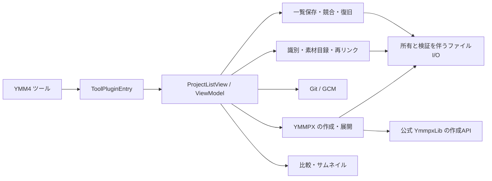

# YMMProjectManager v0.5.0 仕様書

対象は YukkuriMovieMaker 4（YMM4）のプロジェクト管理プラグイン。保存済みのYMM4プロジェクトファイル（PF、`.ymmp`）を一覧から扱い、素材の検査・再リンク、Git履歴、YMMPXによる素材の受け渡しを支援する。

| 基準 | 内容 |
| --- | --- |
| リポジトリ | `hazimeyou/YMMProjectManager` |
| 調査対象 | `codex/ymmpm-v050-r34-vm-acceptance-preparation` の `3a231161f2d103debdda0679c03af0bfe1fe56e8` |
| 回帰・候補DLLに使ったソース | `45fbcba2e8e88413ac7b30f97855439c63aa4bb0`。基準HEADの製品および既存のC#テストソースと同一 |
| 正式対応方針 | Windows 11 x64、.NET 10 Windows Desktop、YMM4 Lite 4.57.0.1、ローカルストレージ |
| 検証状態 | R34の隔離ビルドと合成回帰は完了。現候補の実YMM4・実GitHub認証は未受入。v0.5.0は `NOT_READY`、正式リリースは `RELEASE_NOT_READY` |

この版の根拠は、基準HEADのコードとXAML、README、設計記録、既存試験。文中の「利用可」は製品の操作経路が実装されている状態を指す。実環境での受入は合成試験から独立して評価する。旧フェーズの機能案・試験結果は、その対象コミットと条件を確認して参照する。[README](../../README.md) · [R32の仕様判断](../development/v0.5.0-r32-spec-integration.md) · [R34の検証記録](../development/v0.5.0-r34-results.md)

## 機能索引

| ID | 分野 | 主な仕様 | 詳細 |
| --- | --- | --- | --- |
| PM-01 | プロジェクト一覧 | 登録、開く、一覧から外す、分類、並べ替え、関連PF、状態・表示の保持 | [一覧](02-project-data.md#プロジェクト一覧) |
| PM-02 | 保存と復旧 | JSON保存、未知フィールドの保全、三方向マージ、利用者による解決、下書きと公開の照合 | [保存・競合・中断回復](02-project-data.md#保存競合中断回復) |
| PM-03 | Project Identity | 永続ID、重複・旧行の明示修復、移動と改名の関係確認、メタデータ関連付け | [Project Identity](02-project-data.md#project-identity履歴) |
| PM-04 | 歴史データ | 素材目録の版と分岐を管理。旧世代は検証済みスナップショットから別名PFへ救済 | [素材メタデータと旧世代](02-project-data.md#素材メタデータの版管理) |
| PM-05 | 素材検査・素材プール | 参照先、存在、サイズ、完全SHA-256。明示収集と目録、検索ルート、外部場所の記録 | [素材検査とプール](02-project-data.md#素材検査プール) |
| PM-06 | 素材再リンク | 元名と完全SHA-256を両方照合し、別名PFを安全に保存。確認済み候補の再検証、派生登録と中断回復 | [厳格再リンク](02-project-data.md#厳格な素材再リンク) |
| PM-07 | Git管理 | 状態・履歴・ブランチ、個別Stageと解除、確認付きCommit。既知の素材・秘匿データを公開前に検査 | [Git](03-git-ymmpx.md#git) |
| PM-08 | Gitリモート | Clone、Fetch、確認付きfast-forward Pull、non-force Push、GitHubの閲覧診断・認証、切断・競合・失敗時の処理 | [リモートと認証](03-git-ymmpx.md#信頼境界と認証) |
| PM-09 | YMMPX作成・展開 | 作成は公式 **YmmpxLibPlugin v1.1.0** の `YmmpxLib.dll` と標準API。展開はPM側の検証付きリーダー。旧PM v1/v2は互換読取 | [YMMPX](03-git-ymmpx.md#ymmpx) |
| PM-10 | YMMPX入出力条件 | 許可読取りルート、共通・PF別除外、順序・連番、PSD参照、欠落確認、同梱コピーのUI状態選択、取得と導入案内 | [標準パッケージ・除外・導入](03-git-ymmpx.md#標準パッケージ作成) |
| PM-11 | 画面とホスト連携 | YMM4のツール登録、一覧・ダイアログ・設定、保存済みPFの解決 | [画面と操作](04-host-operations.md#画面と操作) |
| PM-12 | Timeline・描画 | 保存済みサムネイルの最大64点表示、共通時刻・固定および区間のオフセット設定。実Scene描画・Timeline直接反映には受入ゲートがある | [タイムライン・比較・プレビュー](04-host-operations.md#タイムライン比較プレビュー) |
| PM-13 | 設定と診断 | 設定JSONと回復、ログの制限、キャッシュの使用量・所有照合・確認後の清掃 | [設定・キャッシュ・ログ](04-host-operations.md#設定キャッシュログの保存と保全) |
| PM-14 | ビルドと受入 | SDK、ビルド参照、明示配備、配布フロー、合成回帰、実機と認証の受入条件 | [ビルド・運用](04-host-operations.md#ビルド配備配布) · [受入と保守](07-maintenance-and-acceptance.md) |

## 全クラスと型

| 一覧 | 範囲 |
| --- | --- |
| [製品コードの全型一覧](05-product-types.md) | **346型**。クラス、record、struct、interface、enum。入れ子、非公開、partialの全宣言を含む |
| [テスト・開発ツールの全型一覧](06-test-tool-types.md) | **C# 76型、Python 3クラス**。テスト用クラス・合成ホスト・データ構造も含む |

型の完全名、役割、主な操作とデータ、ソースの行を各一覧に記載した。C#はGit管理下の188ファイルを構文解析し、458宣言を完全名でまとめた。ビルド生成物や参照DLLの型は範囲外。型一覧の件数と回帰のテストケース件数は集計対象が異なる。

## 実装と調査の入口

- 一覧を起点に改修する場合は、XAMLのバインディング、`ProjectListViewModel` の対応partial、サービス、関連テストを順に確認する。[画面のバインディング](../../YMMProjectManager/Presentation/Views/ProjectListView.xaml) · [partialの全宣言](05-product-types.md#複数ファイルの全宣言)
- データを更新する場合は、承認時と書込み直前の照合、公開・回復の所有境界、旧形式の読取りを確認する。共通契約と機能固有の条件は [設計思想](../architecture/DESIGN_PHILOSOPHY.md) と [保守・受入](07-maintenance-and-acceptance.md) を参照。
